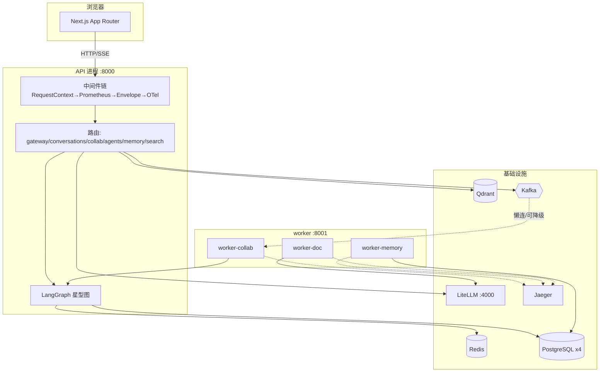

# LegalMind AI 系统架构

> 本文面向工程师，描述仓库当前**代码/配置可核实**的运行时架构。
> 只写已在源码、配置文件或 compose 中确认的事实；凡无法直接核实的一律标注「（待核实）」或省略。
> 术语与交付记录以 [collab-implementation_plan.md](file:///home/jing/Documents/trae_projects/LegalMind%20AI/docs/collab-implementation_plan.md)（§1 锁定决策、§3 交付记录、§4 文件清单）为准。
> 当前仓库已完成 P0~P4 协同重构：会话/群、长期记忆、统一搜索、可观测、旧路由收编、旧本地会话一次性迁移。

---

## 1. 文档定位与范围

- **范围**：`backend/app`（FastAPI API + 三个 worker 角色）、`frontend/app`（Next.js App Router）、`backend/sql/init`（四库 schema 与种子）、根 [docker-compose.yml](file:///home/jing/Documents/trae_projects/LegalMind%20AI/docker-compose.yml) 运行时组件。
- **不在范围**：合同审查业务的内部算法细节（`services/workflows/*`、`services/legal/*` 的检索算法按计划 §4.6「明确不动」）；旧 `/chat`、`/debate/*`、`/court` 的旧实现（已收编/重定向）。
- **权威来源**：启动与中间件以 [main.py](file:///home/jing/Documents/trae_projects/LegalMind%20AI/backend/app/main.py) 为准；运行组件清单与端口以根 [docker-compose.yml](file:///home/jing/Documents/trae_projects/LegalMind%20AI/docker-compose.yml) 为准。

---

## 2. 系统总览

### 2.1 运行时组件

| 组件 | 容器/进程 | 端口 | 说明 |
|---|---|---|---|
| API | `fastapi`（镜像 `legalmind-backend:local`，`uvicorn app.main:app`） | 8000 | 对外 HTTP/SSE 入口 |
| 协同 worker | `worker-collab`（`python -m app.worker.main --role collab`） | 8001 | 消费 `collab-turns`、跑孤儿轮次扫描 |
| 记忆 worker | `worker-memory`（`--role memory`） | 8001 | 消费 `memory-events` |
| 文档 worker | `worker-doc`（`--role doc`） | 8001 | 消费 `doc-tasks`（OCR 异步链路） |
| 前端 | `frontend`（Next.js） | 3000 | `NEXT_PUBLIC_API_URL=http://localhost:8000` |
| Redis | `redis:7-alpine` | 6379 | 心跳/锁/票据/Stream/Pub-Sub/缓存/限流 |
| PostgreSQL | `pgvector/pgvector:pg16` | 5432 | 四库（见 §7） |
| Qdrant | `qdrant/qdrant:v1.9.0` | 6333 | 4 个 Collection（见 §7） |
| LiteLLM | `ghcr.io/berriai/litellm:main-stable` + `litellm-db` | 4000 | LLM 统一代理 |
| Kafka | `apache/kafka:3.7.2`（KRaft 单节点）+ `kafka-init` | 9092 | 3 个业务 topic（默认关闭，见 §9） |
| Jaeger | `jaegertracing/all-in-one:1.60` | 16686/4317 | OTLP trace 后端 |
| Prometheus / Grafana | `prom/prometheus:v2.55.1` / `grafana/grafana:11.3.0` | 9090 / 3001 | profile `observability`，默认不启 |

引用：[docker-compose.yml](file:///home/jing/Documents/trae_projects/LegalMind%20AI/docker-compose.yml#L1-L351)。

### 2.2 架构图



---

## 3. 分层架构

### 3.1 启动顺序（lifespan）

[main.py](file:///home/jing/Documents/trae_projects/LegalMind%20AI/backend/app/main.py#L113-L196) 的 `lifespan`：

1. **Redis**：必须成功，最多重试 5 次（指数退避），失败则服务不启动。
2. 初始化默认管理员账号（`ensure_default_admin`，`admin/admin`），失败仅告警。
3. **PostgreSQL**：必须成功，最多重试 5 次，失败则服务不启动。
4. **LangGraph Checkpointer**：连 `legalmind_app` 建 checkpoint 三表；**失败可降级**（协同中断/恢复暂不可用）。
5. **Qdrant**：可降级（向量检索不可用）。
6. **LLM 客户端**：可降级。
7. 启动内存监控后台任务（`memory_monitor_task`，每 30s；80% 告警、90% 强制 `gc.collect()`）。
8. **Kafka**：**懒连**，启动期不建连，仅记录开关状态。

停机时逆序释放：内存任务、`event_bus`、checkpointer、LLM、Qdrant、PG、Redis。

### 3.2 中间件链

[main.py](file:///home/jing/Documents/trae_projects/LegalMind%20AI/backend/app/main.py#L307-L321) 明确：请求链（由外到内）为

```
Client → RequestContext → Prometheus → Envelope → OTel → ServerError → 路由
```

- `RequestContextMiddleware`（[logging.py](file:///home/jing/Documents/trae_projects/LegalMind%20AI/backend/app/core/logging.py)）：读/生成 `X-Request-ID`，绑定 contextvar + structlog，输出结构化访问日志。
- `PrometheusASGIMiddleware`（[metrics.py](file:///home/jing/Documents/trae_projects/LegalMind%20AI/backend/app/core/metrics.py)）：HTTP 计数与耗时（SSE 长流只计数不记直方图）。
- `LegacyEnvelopeMiddleware`（[response.py](file:///home/jing/Documents/trae_projects/LegalMind%20AI/backend/app/core/response.py)）：把 `/api/` 下旧路由的 JSON 响应统一穿信封；SSE 与非 JSON 透传。
- `instrument_app`（[tracing.py](file:///home/jing/Documents/trae_projects/LegalMind%20AI/backend/app/core/tracing.py)）：FastAPI OTel 埋点，须在所有路由注册后调用。

### 3.3 路由注册与探针

路由注册顺序（[main.py](file:///home/jing/Documents/trae_projects/LegalMind%20AI/backend/app/main.py#L219-L224)）：`gateway → conversations → collab → agents → memory → search`。

探针端点（[main.py](file:///home/jing/Documents/trae_projects/LegalMind%20AI/backend/app/main.py#L227-L304)）：

| 端点 | 语义 |
|---|---|
| `GET /` | 返回服务名与版本 |
| `GET /health` | 聚合 Redis/LLM/PG(四库)/Qdrant 健康 + 内存用量，status ∈ healthy/degraded/unhealthy |
| `GET /healthz` | **存活探针**：进程在即 200，不查任何依赖 |
| `GET /readyz` | **就绪探针**：Redis/PG/Qdrant 健康且 Kafka 生产者已连（或开关关闭）才 200，否则 503；实现见 [health.py](file:///home/jing/Documents/trae_projects/LegalMind%20AI/backend/app/core/health.py) |
| `GET /metrics` | Prometheus `generate_latest()` |

### 3.4 API 路由面（已核实的端点）

- `gateway`（前缀 `/api`，[gateway.py](file:///home/jing/Documents/trae_projects/LegalMind%20AI/backend/app/routers/gateway.py#L34)）：`auth/register`、`auth/token`、`tasks`、`tasks/{task_id}`、`stream/{task_id}`、`circuit-breaker/{name}`、`models`、`dashboard/*`、`documents/*`、`knowledge/search`、`knowledge/list`、`contract/review[/stream]`、`contract/draft-clause`；`chat`、`chat/stream`、`agents/run`、`agents/stream`、`debate/*` 标 `deprecated=True`（旧路由收编，仍可达）。
- `conversations`（前缀 `/api/conversations`，[conversations.py](file:///home/jing/Documents/trae_projects/LegalMind%20AI/backend/app/routers/conversations.py#L219-L689)）：会话 CRUD、`import`、`members`、`my_role`、`messages`（GET/POST）、`forward`、`minutes`、`turns/{turn_id}/checkpoints`、`turns/{turn_id}/fork`。
- `collab`（前缀 `/api/collab/conversations`，[collab.py](file:///home/jing/Documents/trae_projects/LegalMind%20AI/backend/app/routers/collab.py)）：`{id}/events/ticket`（换 60s 票据）、`{id}/events`（SSE v2 订阅）。
- `agents`（前缀 `/api/agents`，[agents.py](file:///home/jing/Documents/trae_projects/LegalMind%20AI/backend/app/routers/agents.py)）：`templates`、`""`（列表）、`{agent_id}`。
- `memory`（前缀 `/api/memories`，[memory.py](file:///home/jing/Documents/trae_projects/LegalMind%20AI/backend/app/routers/memory.py)）：`setting`（GET/PUT 总开关）、CRUD。
- `search`（前缀 `/api/search`，[search.py](file:///home/jing/Documents/trae_projects/LegalMind%20AI/backend/app/routers/search.py)）：`unified`。

---

## 4. 协同编排子系统

### 4.1 LangGraph 星型图

图构建见 [graph.py](file:///home/jing/Documents/trae_projects/LegalMind%20AI/backend/app/services/collab/graph.py)；状态定义见 [state.py](file:///home/jing/Documents/trae_projects/LegalMind%20AI/backend/app/services/collab/state.py)。

- **节点**：`prepare`、`host`、`scheduler`（隐藏内部节点）、`ask_user`、`conclude`；发言辐条 `agent__*`、工具辐条 `tool__*`（LangGraph 1.x 保留 `:` 作命名空间分隔符，故内部名用 `__`，对外一律用 `agent_id`）。
- **固定边**：`START → prepare → host`；所有辐条 / `ask_user` → `host`（唯一固定回边）；`conclude → END`。
- **动态边**：`host` 与 `scheduler` **无任何固定出边**，去向 100% 由运行时 `Command(goto=)` 决定。
- **护栏**（[graph.py](file:///home/jing/Documents/trae_projects/LegalMind%20AI/backend/app/services/collab/graph.py#L335-L478)）：① 候选白名单（越权目标回退模板默认顺序）；② `max_rounds` 与单 turn 预算硬顶；③ 排序智能体失败降级模板默认顺序，不中断整轮。

### 4.2 主持人（host）与隐藏调度智能体（scheduler）

- **host** 只产出「程序性指令 + 口语发言」，**不再选下一位发言者**（决策 D14）；指令取值 `HOST_DIRECTIVES = ("continue", "ask_user", "verdict", "conclude")`；结构化 directive JSON 在服务端缓冲剥离，不推给用户。
- **scheduler** 独占「next_speaker / 是否续轮」决策，**不进 `agent_registry`、不产生任何气泡**，对用户全程隐藏（图内 `HIDDEN_INTERNAL_NODES = (SCHEDULER_NODE,)`）。
- 生产装配见 [production.py](file:///home/jing/Documents/trae_projects/LegalMind%20AI/backend/app/services/collab/production.py)：按模板 `adapter`（`generic`/`court`）在**调用时**查 `state.case_type` 分派真实件（HostSkill / SchedulerSkill / agent_runner / tool_runner / interaction_card / conclude_producer / speaker_notice / memory_recall）；同一张编译图服务所有模板。

### 4.3 轮次执行器 / 恢复引擎（TurnRunner）

[runner.py](file:///home/jing/Documents/trae_projects/LegalMind%20AI/backend/app/services/collab/runner.py)：以 `collab_turns` 台账为权威，把「用户一次发言」驱动成可中断、可续跑、可重试、可 fork 的轮次。

- **状态机**：`running → interrupted(ask_user/接管) → running(resume) → completed`；异常累计 `attempts`，达 `TURN_MAX_ATTEMPTS` → `failed` + DLQ。
- **租约心跳**：执行期间按 `TURN_HEARTBEAT_INTERVAL` 续写 worker 心跳并续期 Redis 轮次锁；超 `TURN_LEASE_SECONDS` 的 `running` 轮次视为僵死孤儿，可被其它副本认领（[consumers/collab.py](file:///home/jing/Documents/trae_projects/LegalMind%20AI/backend/app/worker/consumers/collab.py) 的 `orphan_scan_loop`）。
- **checkpoint 续跑**：`astream` 每个 super-step 原子提交；`thread_id` 取 **turn_id**（非 conversation_id），跨轮上下文从 `messages` 表播种最近 `TURN_HISTORY_LIMIT` 条。
- **中断/恢复**：`astream` 返回 `__interrupt__` → status=interrupted 并推 `interaction_required`；`Command(resume=...)` 从断点精确续跑。
- **fork**：`aget_state_history` 列 checkpoint 时间线，从指定 checkpoint 派生新轮次（旧分支保留）。

**Kafka 与进程内双模式共用同一执行器**：Kafka 关闭时由 API 路由依赖的进程内单例 `get_turn_runner()` 驱动；开启时由 `worker-collab` 消费器驱动。

### 4.4 SSE v2 事件协议

- **订阅通道**：`GET /api/collab/conversations/{id}/events`，先 `POST .../events/ticket` 换一次性 60s 短票据（EventSource 无法带 `Authorization` 头，故凭票据经 query 鉴权，URL 不放 JWT）。
- **回放 + 实时双通道**：服务端先按 `Last-Event-ID` 从 Redis Stream 回放缺口，再订阅 Pub/Sub 实时推送；每条 SSE `id` = Redis Stream entry id（严格单调），订阅端按 id 去重 → 刷新/断网重连「不丢不重」。每 15s 发 `: ping` 注释帧保活。
- **流式三事件（S1）**：所有 AI 消息 token 级流式，采用 `message_start`（分配 `message_id`/`event_key`）→ 多帧 `message_delta`（增量文本）→ `message_end`（定稿落库）；前端按 `message_id` 追加合并，严禁整包替换。前端可收到的事件名见 [sse.ts](file:///home/jing/Documents/trae_projects/LegalMind%20AI/frontend/app/lib/sse.ts#L21-L31)：`message_start/message_delta/message_end/status/interaction_required/message/done/error`。

### 4.5 幂等键与工具节点

- **幂等**：`event_key = {turn_id}:r{round}:{agent_id}:{seq}`，`message_id = uuid5(event_key)`（[agent_nodes.py](file:///home/jing/Documents/trae_projects/LegalMind%20AI/backend/app/services/collab/agent_nodes.py#L319-L324)）；落库走 `INSERT ... ON CONFLICT (event_key) DO NOTHING`，实现「先查库后发」。
- **工具辐条**（检索类 Agent，`is_tool`）：不占主串行发言位，由编排器在**轮首并行预取**（`prepare` 节点 `asyncio.gather`），结果入共享上下文 `state.retrieved` → 各 Agent 的资料块，并产出引用卡（`msg_type=card`）。见 [tool_nodes.py](file:///home/jing/Documents/trae_projects/LegalMind%20AI/backend/app/services/collab/tool_nodes.py)。

### 4.6 模板与纪要

- **模板表驱动**：`case_roster_templates` 定义 `host_agent_id`、`roster`、`max_rounds`、`adapter` 等；新增模板=插一行数据。种子含 8 个模板（contract 等 generic + court），见 [05-seed-agents-templates.sql](file:///home/jing/Documents/trae_projects/LegalMind%20AI/backend/sql/init/05-seed-agents-templates.sql)。
- **会商纪要**：[minutes.py](file:///home/jing/Documents/trae_projects/LegalMind%20AI/backend/app/services/collab/minutes.py) 由用户在群内手动触发 `POST /api/conversations/{id}/minutes`，书记员（`clerk`）汇总本会话各方观点，以 `msg_type=minutes` 落库，事件协议与 Agent 辐条一致。

---

## 5. 长期记忆子系统

权威内容在 PG `legalmind_app.memories`，向量在 Qdrant `user_memories`（1024/Cosine）。相关文件：[store.py](file:///home/jing/Documents/trae_projects/LegalMind%20AI/backend/app/services/memory/store.py)、[pipeline.py](file:///home/jing/Documents/trae_projects/LegalMind%20AI/backend/app/services/memory/pipeline.py)、[routers/memory.py](file:///home/jing/Documents/trae_projects/LegalMind%20AI/backend/app/routers/memory.py)。

- **按 user_id 收敛**：CRUD 一律带 `user_id` 过滤，杜绝跨用户越权；`scope ∈ (user, case)`、`status ∈ (active, archived)`、`importance ∈ 1..5`、`embedding_status ∈ (pending, done, failed)`。
- **向量侧尽力而为**：嵌入/向量写失败不阻断 CRUD，只回写 `embedding_status=failed`；归档（`archived`）即从向量库摘除。
- **总开关**：Redis 键 `legalmind:memory:enabled:{user_id}`，缺省为开；关闭后**不写也不读**；`GET/PUT /api/memories/setting`。
- **自动抽取（T2.2）**：一轮对话成功收尾 → `dispatch_memory_event` 派发记忆事件 → 抽取候选 → 与既有记忆向量比对（cosine）→ 三重判定：
  - `cosine ≥ MEMORY_MERGE_THRESHOLD`（0.90）→ **合并**（内容合并 + `importance` 取高）；
  - `MEMORY_DEDUP_THRESHOLD`（0.75）~ 0.90 → **去重提示**（新增但标记疑似重复）；
  - `< 0.75` → **新增**。
- **召回注入（T2.3）**：`prepare` 节点按用户语义召回 top `MEMORY_RECALL_TOP_K`（5）条注入独立「已召回的用户背景记忆」块，最低相似度 `MEMORY_RECALL_MIN_SCORE`（默认 0=不过滤）；召回件 [memory_recall.py](file:///home/jing/Documents/trae_projects/LegalMind%20AI/backend/app/services/collab/memory_recall.py)。开关关闭即不读不写，fail-open。
- **抽取模型**：`MEMORY_EXTRACT_MODEL = "deepseek-flash"`；单轮喂给抽取器最多 `MEMORY_TURN_MESSAGES_LIMIT`（40）条消息；失败重试 `MEMORY_MAX_ATTEMPTS`（3）次后进 `memory-events-dlq`。

---

## 6. 统一搜索子系统

[search.py](file:///home/jing/Documents/trae_projects/LegalMind%20AI/backend/app/routers/search.py) 的 `POST /api/search/unified`：单搜索框，后端**并行四路召回**并分组返回，供前端 Tab 过滤（全部/法规/类案/我的记忆/会话记录）。

- `law`：四级 RAG（`retrieve_legal_knowledge`，`domain=law`）。
- `judge`：四级 RAG（`domain=judge`，类案/裁判文书）。
- `memory`：用户长期记忆（Qdrant `user_memories` 语义召回 + PG 补水，仅 `active`，受总开关约束）。
- `messages`：本人会话记录（PG `messages` ILIKE，按 `conversations.user_id` 隔离，通配符已转义）。

**失败隔离（fail-open）**：单路超时（`SOURCE_TIMEOUT=20.0s`）/异常只记日志、置空该路结果并写入 `errors`，不影响其余三路，**绝不抛 500**。用户隔离：`memory`/`messages` 严格按登录用户收敛。

---

## 7. 数据与存储拓扑

### 7.1 PostgreSQL（4 库）

[pg_client.py](file:///home/jing/Documents/trae_projects/LegalMind%20AI/backend/app/core/pg_client.py) 定义四套独立引擎（`judge_engine`/`lawyer_engine`/`law_engine`/`app_engine`）；`ENGINES` dict 仅含三知识库，应用库单列 `app_engine`。schema 见 [sql/init/](file:///home/jing/Documents/trae_projects/LegalMind%20AI/backend/sql/init)。

| 库 | 关键表 |
|---|---|
| `judge_db` | `judge_cases`、`sentencing_guidelines`、`trial_procedures` |
| `lawyer_db` | `defense_strategies`、`evidence_rules`、`contract_review_templates`、`legal_opinions` |
| `law_db` | `legal_provisions`、`judicial_interpretations`、`administrative_regulations` |
| `legalmind_app` | `conversations`、`conversation_members`、`messages`、`agent_registry`、`case_roster_templates`、`memories`、`collab_turns`、`host_decisions` |

- 三知识库表含 `embedding vector(1024)` + ivfflat 索引；**应用库不含 vector 扩展**（两套 metadata 绝不混用）。
- **LangGraph Checkpointer** 另在 `legalmind_app` 建三表：`checkpoints` / `checkpoint_blobs` / `checkpoint_writes`（[checkpoint.py](file:///home/jing/Documents/trae_projects/LegalMind%20AI/backend/app/core/checkpoint.py)）。
- 消息表有确定性幂等键 `event_key`（唯一索引 `uq_messages_event_key`）与 fork 时间旅行的 `fork_parent_message_id`。

### 7.2 Redis 键域

[redis_client.py](file:///home/jing/Documents/trae_projects/LegalMind%20AI/backend/app/core/redis_client.py)：

| 键/前缀 | 用途 |
|---|---|
| `legalmind:task_queue` / `legalmind:task_status:{id}` / `legalmind:task_stream:{id}` | 旧任务队列与状态/事件流（Stream MAXLEN 1000） |
| `legalmind:conv:{id}:messages:recent` | 最近 20 条热缓存（List，TTL 600s） |
| `legalmind:conv:{id}:events` | SSE 事件 Stream（MAXLEN 500）+ Pub/Sub 同名双通道 |
| `legalmind:lock:conv:{id}` | 同群轮次锁（`SET NX PX`，TTL 600000ms；Lua 令牌比对释放） |
| `legalmind:sse_ticket:{ticket}` | SSE 一次性短票据（TTL 60s，`GETDEL`） |
| `legalmind:memory:enabled:{user_id}` | 记忆总开关 |
| `legalmind:worker:{worker_id}` / `legalmind:workers:online` | worker 心跳 key 与在线 ZSET |
| `legalmind:cb:{name}` | 熔断器状态（服务名隔离） |
| `legalmind:docs:{doc_id}` | 上传文档元信息 |
| `ratelimit:{key}` | 滑动窗口限流（gateway） |
| `legalmind:llm_cache:` | LLM 结果缓存（TTL 3600s） |

### 7.3 Qdrant Collections

[qdrant_client.py](file:///home/jing/Documents/trae_projects/LegalMind%20AI/backend/app/core/qdrant_client.py)：`judge_knowledge`、`lawyer_knowledge`、`law_knowledge`（三知识库）+ `user_memories`（用户长期记忆，按 `user_id` 隔离，payload 不含 domain）。向量维度 `VECTOR_SIZE = EMBEDDING_DIM`（1024），距离 Cosine。

### 7.4 Kafka Topics

[docker-compose.yml](file:///home/jing/Documents/trae_projects/LegalMind%20AI/docker-compose.yml#L117-L133) 的 `kafka-init` 建 3 个业务 topic（3 partition、单副本）：`collab-turns`、`memory-events`、`doc-tasks`。DLQ topic 名由 [config.py](file:///home/jing/Documents/trae_projects/LegalMind%20AI/backend/app/core/config.py#L86-L91) 定义：`collab-turns-dlq`、`memory-events-dlq`、`doc-tasks-dlq`。

---

## 8. 横切能力

### 8.1 统一信封与错误码

- **信封**：[response.py](file:///home/jing/Documents/trae_projects/LegalMind%20AI/backend/app/core/response.py)。成功 `{code:0, message, data, request_id}`；失败 `{code, message, detail, retryable, request_id}`。新路由经 `EnvelopeRouter` 走信封；旧路由由 `LegacyEnvelopeMiddleware` 统一穿信封（SSE 与非 JSON 透传）。
- **错误码**：[errors.py](file:///home/jing/Documents/trae_projects/LegalMind%20AI/backend/app/core/errors.py#L18-L45)。段位 `0` 成功 / `40xxx` 客户端（`40101` 未认证、`40102` token 过期、`42901` 限流、`50901` 轮次锁冲突）/ `50xxx` 服务端（`50201` LLM 失败、`50301` 熔断中、`50310` Kafka 降级、`50401` 超时）。每码自带 HTTP 状态与 `retryable`；SSE error 事件复用同一组错误码。

### 8.2 日志与追踪与指标

- **request-id 全链路**：[logging.py](file:///home/jing/Documents/trae_projects/LegalMind%20AI/backend/app/core/logging.py) 用 structlog JSON（可切 console），把 stdlib 日志桥接统一为 JSON；信封 `request_id` 与响应头 `X-Request-ID` 同源。日志字段含 `request_id/user_id/method/route/status/latency_ms`。
- **OTel + Jaeger**：[tracing.py](file:///home/jing/Documents/trae_projects/LegalMind%20AI/backend/app/core/tracing.py)，**常开**（`OTEL_ENABLED`），FastAPI/httpx/SQLAlchemy/Redis 自动埋点，W3C `traceparent` 传播，OTLP gRPC 批量异步导出；Jaeger 不可达仅丢 trace、不阻断业务。默认不捕获请求/响应头，`request_id` 挂到 server span 便于对账。
- **Prometheus**：[metrics.py](file:///home/jing/Documents/trae_projects/LegalMind%20AI/backend/app/core/metrics.py) 预置 `legalmind_http_*`、`legalmind_llm_*`、`legalmind_kafka_*`（含 consumer lag）、`legalmind_worker_*`、`legalmind_collab_turn_*`、`legalmind_agent_*`、`legalmind_web_search_calls_total`、`legalmind_memory_*`、`legalmind_doc_task_total`；`/metrics` 直接输出。

### 8.3 熔断 / 重试 / 降级

[resilience.py](file:///home/jing/Documents/trae_projects/LegalMind%20AI/backend/app/core/resilience.py)：

- **重试**：tenacity 异步，指数退避 0.5s→1s→2s + 抖动；默认 3 次；仅对 429/502/503/504、连接错误、超时重试；总预算 30s。
- **超时分层**：connect 5s、普通读 30s、LLM 流式首字节 30s（迭代读沿用 client 120s）；见 [config.py](file:///home/jing/Documents/trae_projects/LegalMind%20AI/backend/app/core/config.py#L47-L52)。
- **熔断**：`RedisCircuitBreaker` 按服务名隔离（`litellm`/`llm_deepseek`/`local_model`/`ocr`/`qdrant`），状态存 Redis `legalmind:cb:{name}`。
- **降级 fail-open**：熔断/Redis 故障时放行，不因熔断基础设施故障阻断业务；全失败时抛携带错误码的 `BizException`，而非裸 500。

### 8.4 幂等

- **消息幂等**：`event_key` 唯一索引 + `INSERT ... ON CONFLICT DO NOTHING`（见 §4.5）。
- **轮次幂等**：`collab_turns` 终态（`completed`/`failed`）直接 ack 跳过；同一 turn 由 Redis 轮次锁保证单执行者。
- **任务幂等**：`create_task_record` / `enqueue_task` 对已存在 task_id 幂等返回。

---

## 9. 关键设计决策与约束

以下为计划 §1 已拍板、且在当前代码中落地的硬约束：

1. **应用数据独立新库** `legalmind_app`，三知识库库与三套 Qdrant 知识库 Collection **不动**（D2）。
2. **Agent 串行、一人一条独立气泡**；`direct` 会话白名单收窄到唯一 `target_agent_id`（D3/D9/B1）。
3. **发言顺序由隐藏 scheduler 决定**，host 只做程序性决策与发言；**代码只做护栏**（A1/D14）。
4. **主机/调度 Agent 对用户隐藏**：scheduler 不进注册表、不产生气泡；轮次提示以中性「下面是 X 发言」分隔条显性化，不暴露主持人身份。
5. **最终判断由法官 Agent 出**：`court` 模板 host=`judge`，`verdict` 经 `conclude_producer` 产出判决书；`conclude` 后追加产出 fail-open。
6. **中断恢复用 LangGraph 原生机制**：`interrupt()/resume` + PG checkpoint 按 super-step 续跑 + state history fork（A2）。
7. **实时体感统一走新 collab SSE**：`/api/collab/conversations/{id}/events`，**不复用旧 `/debate/stream`**（D19）。
8. **旧路由收编（T4.1/T4.3）**：后端 `/chat`、`/debate/*`、`/agents/*` 等标 `deprecated=True` 但代码保留（旧**前端**页面文件已物理删除）；旧前端入口由服务端重定向兜底（[next.config.js](file:///home/jing/Documents/trae_projects/LegalMind%20AI/frontend/next.config.js#L4-L13)：`/chat`→`/messages`、`/court`→`/messages?template=court`、`/knowledge`→`/search`、`/cases`→`/memory?view=cases`），`/dashboard` 由客户端 [AuthGuard.tsx](file:///home/jing/Documents/trae_projects/LegalMind%20AI/frontend/components/AuthGuard.tsx#L11-L19) 兜底重定向到 `/messages`。
9. **LLM 密钥只经内部 `get_llm_client`（LiteLLM 代理）**：`DEEPSEEK_API_KEY` 等仅注入 `litellm` 容器与代理配置，业务代码经 `LITELLM_PROXY_URL`/`LITELLM_VIRTUAL_KEY` 调用（[llm_client.py](file:///home/jing/Documents/trae_projects/LegalMind%20AI/backend/app/core/llm_client.py)）；根 compose 已移除对 `fastapi` 容器的 `DEEPSEEK_API_KEY` 透传，**代码层亦已删除直连分支——未配置代理时 fail-closed**，真实 key 仅 `litellm` 服务持有。
10. **localStorage 凭证按用户隔离**：Token 键为 `legalmind_token:{username}`，避免多账号串号（[http.ts](file:///home/jing/Documents/trae_projects/LegalMind%20AI/frontend/app/lib/http.ts#L16-L26)）。
11. **Kafka 可降级为进程内**：`ENABLE_KAFKA=false` 时事件走进程内降级（记忆抽取走后台任务、轮次由 API 进程内执行器驱动），broker 故障自动降级不阻断业务。
12. **追踪常开 / Kafka 默认关**：OTel 默认启用 + Jaeger 进 compose 默认服务；Kafka 默认 `false`，开启后懒连（D6/D7）。
13. **合同审查零功能改动**：仅穿横切层（信封/日志/重试/追踪）并做回归（D5）。
14. **所有 AI 消息一律 token 级流式**（S1），前端按 `message_id` 追加合并，严禁整包替换。

---

## 10. 技术栈与版本（已核实）

**后端**（[requirements.txt](file:///home/jing/Documents/trae_projects/LegalMind%20AI/backend/requirements.txt)）：

- Python **3.12**（[Dockerfile](file:///home/jing/Documents/trae_projects/LegalMind%20AI/backend/Dockerfile) `python:3.12-slim`）。
- FastAPI `>=0.135.0`、uvicorn `>=0.44.0`、sse-starlette `>=3.3.0`。
- pydantic `>=2.12.0`、pydantic-settings `>=2.13.0`、PyJWT `>=2.8.0`。
- redis[hiredis] `>=5.0.0`、sqlalchemy[asyncio] `>=2.0.50,<2.1.0`、asyncpg `>=0.31.0`、pgvector `>=0.4.0`、qdrant-client `>=1.18.0`。
- langchain `>=1.3,<2`、langchain-openai `>=1.1,<2`、langgraph `>=1.2,<2`、langgraph-checkpoint `>=4.1,<5`、langgraph-checkpoint-postgres `>=3.1,<3.2`、psycopg[binary] `>=3.2,<4`。
- sentence-transformers `>=2.7.0`、transformers `>=4.44.0`、torch `>=2.0.0`、aiokafka `>=0.12.0`、tenacity `>=8.2.0`、structlog `>=24.1.0`。
- OpenTelemetry（sdk/distro/otlp-grpc-exporter + fastapi/httpx/sqlalchemy/redis instrumentation）、prometheus-client `>=0.20.0`、PyMuPDF、python-docx、Pillow、numpy、aiofiles、aiohttp。
- 测试：pytest `>=8.0.0`、pytest-asyncio `>=0.23.0`。

**前端**（[package.json](file:///home/jing/Documents/trae_projects/LegalMind%20AI/frontend/package.json)）：Next.js `^14.2.35`、React `^18.2.0`、zustand `^4.4.0`、framer-motion、lucide-react、three / @react-three/fiber / @react-three/drei；TypeScript `^5.2.2`、Tailwind `^3.4.19`。

**基础设施镜像**：redis:7-alpine、pgvector/pgvector:pg16、postgres:16-alpine、qdrant/qdrant:v1.9.0、apache/kafka:3.7.2、jaegertracing/all-in-one:1.60、ghcr.io/berriai/litellm:main-stable、prom/prometheus:v2.55.1、grafana/grafana:11.3.0。

**模型配置**（[config.py](file:///home/jing/Documents/trae_projects/LegalMind%20AI/backend/app/core/config.py#L23-L30)）：Embedding `models/Qwen/Qwen3-Embedding-0.6B`（dim 1024，device cuda）、Reranker `Qwen/Qwen3-Reranker`（cpu，top_n 20）。

---

## 11. 待办 / 已知限制

- 前端协同组件位于 `frontend/components/collab/`（`ConversationView`/`ConversationList`/`ChatArea`/`NewConversationWizard`/`InteractionCard`/`Avatar`/`RightRail`/`LegacyMigrationBanner` 等），并非 `frontend/app/components/`（该目录为空）；记忆与搜索组件分别在 `frontend/components/memory/`、`frontend/components/search/`。
- `judge_engine`/`lawyer_engine`/`law_engine` 的连接池与 `app_engine` 分开配置（知识库 `pool_size=5`，应用库 `pool_size=10`）；跨库一致性依赖各自短事务，无分布式事务。
- **Kafka 默认为关闭**（`ENABLE_KAFKA=false`）；生产高并发需显式开启并配多节点 KRaft 集群（当前 compose 为**单节点** broker+controller 同进程，计划注明「生产需换多节点集群」）。
- **单节点 Jaeger all-in-one / Prometheus / Grafana** 为本地可观测形态，生产部署形态（持久化、告警）**（待核实）**。
- 旧路由（`/chat`、`/debate/*`、旧 `/knowledge` 等）保留可选达但已 `deprecated`，后续是否下线**（待核实）**。
- OCR 走外部 PaddleOCR AIStudio 任务 API（[config.py](file:///home/jing/Documents/trae_projects/LegalMind%20AI/backend/app/core/config.py#L65-L70)），依赖 `OCR_API_TOKEN`；token 缺失时异步链路不可用。
- **（待核实）** 前端页面中 `login`/`dashboard`/`documents`/`messages`/`memory`/`search` 有 `page.tsx`；`cases`/`chat`/`court`/`knowledge` 为空目录（按 D17 重定向）。
